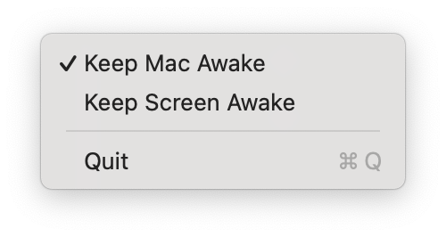

<p align="center"></p>

<h1 align="center">Keep Mac Awake</h1>

<p align="center">
Keep your Mac awake with the lid closed, from the menu bar.<br>
Free and open source. No App Store needed, so it's handy on work laptops where the App Store is blocked.
</p>

<p align="center"></p>

## What it is

A menu bar shortcut for two built-in macOS commands, so you don't have to remember them:

| Menu item | Same as running | What it does |
|---|---|---|
| **Keep Mac Awake** | `sudo pmset -a disablesleep 1`<br>(`0` turns it off) | Your Mac doesn't sleep, even with the lid closed. Downloads, builds and AI agents keep running. The screen still turns off and locks. |
| **Keep Screen Awake** | `caffeinate -d` | The screen doesn't turn off while you're idle. Switches off when you quit the app. |

`caffeinate` alone can't stop the sleep that happens when you close the lid. `pmset disablesleep` can, and that's the one this app switches for you.

## Install

Needs macOS 14 or later and an admin account. Paste this into Terminal:

```bash
curl -fsSL https://raw.githubusercontent.com/HJ29/keep-mac-awake/main/install.sh | bash
```

It downloads the latest [release](https://github.com/HJ29/keep-mac-awake/releases) into `~/Applications` and starts it. macOS asks for your password once. `pmset` needs root, so the installer adds a sudoers rule that allows only `pmset -a disablesleep 1` and `0`, nothing else.

**With an AI agent** (Claude Code, Codex, opencode, …), paste:

```text
Install https://github.com/HJ29/keep-mac-awake for me by following its AGENTS.md.
```

**From source:** releases are built by [GitHub Actions](.github/workflows/release.yml) from this code, and `gh attestation verify KeepMacAwake.zip -R HJ29/keep-mac-awake` proves it. To build it yourself instead, install the Xcode Command Line Tools (`xcode-select --install`), then:

```bash
git clone https://github.com/HJ29/keep-mac-awake.git
cd keep-mac-awake
./install.sh
```

To update, run the install again. To start it at login, add KeepMacAwake under System Settings → General → Login Items. To remove it:

```bash
curl -fsSL https://raw.githubusercontent.com/HJ29/keep-mac-awake/main/uninstall.sh | bash
```

## Good to know

- With the lid closed, keep it plugged in and out of a bag. It still makes heat.
- Keep Screen Awake also stops auto-lock. Press Control-Command-Q to lock when you walk away.
- Keep Mac Awake is a system setting, so it stays on after you quit the app. Switch it off in the menu first.

## License

[MIT](LICENSE)
